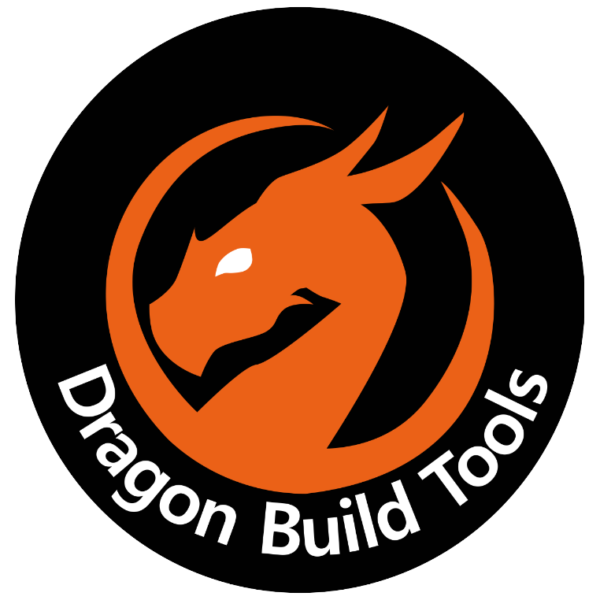

<p align="center">
  
</p>

<h1 align="center">Dragon Build Tools v2.2</h1>

<p align="center">
  Sculpting brushes, 3D model importing, live animations, video screens, 3D WFC, terrain heightmaps, and resource-pack <code>.obj</code> exporting for <b>FastAsyncWorldEdit</b>.
</p>

---

Dragon Build Tools (DBT) is a Paper/Spigot addon for FastAsyncWorldEdit that adds sub-block sculpting & color-blur brushes, tools for converting 3D meshes, images, heightmaps, animated GIFs/videos, and 3D text into Minecraft builds, 3D Wave Function Collapse generation, and resource-pack `.obj` + `.mtl` exporting for Blender.

Instead of only placing full cubes, DBT checks surface slopes and sub-voxel occupancy to place directional stairs, top/bottom slabs, walls, fences, carpets, and snow layers (1-7) where they fit, while avoiding ugly stacked stairs or mismatched wood/terracotta hues on neutral stone and white builds. Brushes and static generators run through normal FAWE edit sessions (`//undo` and `//redo`) or copy straight to your `//paste` clipboard with `-o`.

## What's New in v2.2

- **3D Gaussian Color Blur Brush (`//gblur` / `/dbr gblur`):** Smoothly blurs block colors across gradients and seams using a normalized 3D Gaussian kernel (air and water never darken colors). Sub-blocks (stairs, corner stairs, top/bottom slabs, walls, fences, trapdoors, carpets, panes, buttons, plates, and leaves) have their colors blurred too while strictly staying the exact sub-block, facing, half, and connection state they were originally.
- **Sub-Block BlendBall Brush (`//subblend` / `/dbr subblend`):** Works like FAWE's `/br blendball`, upgraded to `2x2x2` (`0.5`-block) octant resolution. Keeps flat floors and walls untouched while smoothing jagged `1x1x1` steps, 3D corners, overhangs, bumps, and potholes into directional straight stairs, `inner`/`outer` corner stairs, and top/bottom slabs while blending neighbor material families.
- **Resource Pack Models & UV Texture Atlas in `//exportobj` (v2.1):** Drop any `.zip` resource pack or unzipped pack folder into `plugins/DragonBuildTools/resourcepacks/` and `//exportobj` exports custom 3D JSON block models, blockstates, biome tints, and a crisp `<name>_atlas.png` UV texture sheet ready for Blender renders (with zero Mojang assets bundled in the JAR and a 1,200-block color fallback table).
- **In-Game Studio GUI & Starter Demos (`/dbt`):** 1-click brush equipping, local asset folder browsers, built-in starter demos (`/dbt demo`), clipboard export (`-o`), and a live animation controller.

## Requirements

- **Server:** Paper, Purpur, or Spigot (`1.20.4` - `1.21.x`, `26.1` - `26.3`)
- **Java:** 21+
- **Dependency:** [FastAsyncWorldEdit (FAWE)](https://intellectualsites.github.io/download/fawe.html)
- *(Optional)* `ffmpeg` on the host machine if you want to load `.mp4` / `.webm` / `.mov` files with `//video`. Animated `.gif` files work out of the box with no extra dependencies.

## Installation

1. Put `DragonBuildTools-2.2.0.jar` into your server's `plugins/` folder alongside FastAsyncWorldEdit.
2. Start or restart the server.
3. Run `/dbt` in-game to open the Studio GUI and click any starter demo, or drop your own files into `plugins/DragonBuildTools/` (`models/`, `resourcepacks/`, `images/`, `videos/`, `animations/`, `heightmaps/`) or pass `http://` / `https://` URLs directly in commands.

## Commands

### Studio GUI & Starter Demos (`/dbt`)
```text
/dbt
/dbt demo <dragon|cinema|knot|terrain|text|setup>
/dbt help [topic]
/dbt files
```
Running `/dbt` as a player opens the chest GUI where you can equip sculpting brushes, launch starter demos, click files from your folders (Left-Click to place, Right-Click to copy to `//paste`), or control running animations.

### Gaussian Color Blur Brush (`//gblur`)
```text
//gblur [radius=5] [sigma=1.6] [strength=1.0] [-p] [-h] [-m <mask>]
/dbr gblur [radius=5] [sigma=1.6] [strength=1.0] [-p] [-h] [-m <mask>]
```
Aliases: `/gblur`, `//colorblur`, `//blurbrush`

Hold any item and run `//gblur` to bind a 3D Gaussian color blur brush. Works with FAWE `/size`, `//mask`, `//gmask`, and `//undo`.
- Blurs colors smoothly across full blocks **and** sub-blocks while strictly keeping every sub-block's original class and blockstate (`*_stairs` stay stairs with the exact same `facing`, `half`, and corner `shape`; `*_slab`, `*_wall`, `*_fence`, `*_trapdoor`, `*_carpet`, `*_pane`, `*_button`, `*_pressure_plate`, and `*_leaves` all keep their exact geometry).
- `-p` restrict blurred colors to block families already inside the brush sphere
- `-h` hard sphere edge (disable smooth outer-rim feathering)
- `-m <mask>` optional WorldEdit brush mask

### Sub-Block BlendBall Brush (`//subblend`)
```text
//subblend [radius=5] [minDiff=1] [-a] [-g] [-w] [-y] [-m <mask>]
/dbr subblend [radius=5] [minDiff=1] [-a] [-g] [-w] [-y] [-m <mask>]
```
Aliases: `/subblend`, `//sblend`, `//blendballsub`, `//subblendball`

Hold any item and run `//subblend` to bind a `2x2x2` sub-voxel BlendBall brush.
- Decodes existing full cubes, stairs, slabs, walls, trapdoors, and snow layers into an 8-octant (`0.5`-block) grid, smooths occupancy with 26-neighbor BlendBall voting, and synthesizes backed directional straight stairs, `inner_left`/`inner_right`/`outer_left`/`outer_right` corner stairs, and top/bottom slabs while blending neighbor material families.
- `-a` compare solid vs air only (keep existing block materials)
- `-g` smooth geometry into stairs/slabs without blending neighbor materials
- `-w` allow walls on thin vertical ribs/pillars
- `-y` allow snow layers on gentle slopes
- `-m <mask>` optional WorldEdit brush mask

### 3D Models (`//model`)
```text
//model <file|url> [size=48] [block] [rx=0] [ry=0] [rz=0] [-s] [-d] [-g] [-l] [-b] [-c] [-o]
```
Aliases: `//3dmodel`, `//voxel`, `//dbtmodel`

Imports `.obj` (including `.mtl` materials and textures), `.glb`, `.gltf`, `.stl`, `.ply`, `.vox`, and `.off` files from `plugins/DragonBuildTools/models/` or a URL.
- `-s` fill the inside of the mesh solid
- `-l` apply directional shading
- `-b` full blocks only (turn off stairs/slabs/sub-blocks)
- `-d` disable color dithering
- `-g` disable stained glass for translucent surfaces
- `-c` center on your position
- `-o` copy to your `//paste` clipboard instead of placing

### Export Selection to `.OBJ` (`//exportobj`)
```text
//exportobj <name> [pack|auto|colors] [-p <pack>] [-c] [-m]
```
Aliases: `//schemtoobj`, `//toobj`

Exports your WorldEdit selection to `plugins/DragonBuildTools/exports/<name>.obj` (+ `<name>.mtl` and `<name>_atlas.png`) with hidden-face culling, resource-pack 3D block models, UV coordinates, biome foliage/grass tints, and sub-block geometry for stairs, slabs, fences, walls, cross plants, trapdoors, lanterns, and snow layers.
- Drop any `.zip` resource pack or unzipped pack folder into `plugins/DragonBuildTools/resourcepacks/` to export using that pack's textures and 3D JSON block models (layered over FAWE's runtime-downloaded client asset JAR, with no vanilla textures embedded in the plugin).
- `[pack]` or `-p <pack>` pick a specific pack in `resourcepacks/` (or pass `colors` for flat solid-color materials without a texture atlas)
- `-c` export from your `//copy` clipboard instead of your selection
- `-m` also copy the exported `.obj` + `.mtl` (+ `_atlas.png`) into `models/` so you can re-import or animate it with `//animmodel`

### Animated 3D Models (`//animmodel`)
```text
//animmodel <file|folder|url> [size=40] [mode=wingflap] [frames=16] [fps=8] [block] [-s] [-b] [-n] [-c]
```
Aliases: `//3danim`, `//animate3d`

Animates a 3D model in the world by pre-voxelizing frames and only swapping blocks that change between frames. Supports multi-frame `.vox` files, numbered mesh folders in `plugins/DragonBuildTools/animations/`, or procedural motion modes (`wingflap`, `spin`, `hover`, `breathe`, `swing`) on a static model.
- `-n` play once without looping

### Video & GIF Screens (`//video`)
```text
//video create <name> <file|url> [width=64] [height=0] [fps=10] [maxFrames=60] [-f] [-u] [-d] [-g] [-n] [-c] [-a]
```
Aliases: `//gif`, `//screen`, `//dbtvideo`

Creates named in-world screens from `.gif` files, image folders, or video files in `plugins/DragonBuildTools/videos/`. Multiple screens can run at the same time using the same source file.
- `-f` flat on the floor
- `-u` curved screen
- `-a` start playing right away
- Subcommands: `start`, `pause`, `stop [-r]`, `restart`, `seek`, `fps`, `loop`, `move`, `clone`, `remove [-k]`, `info`, `list`

### Animation Control (`//anim`)
```text
//anim <list|start|pause|resume|speed|frame|stop> [name|id|all] [value] [-k]
```
General controller for both `//animmodel` and `//video` instances. Stopping an animation restores the original terrain unless `-k` is set.

### 3D Wave Function Collapse (`//newwfc`)
```text
//newwfc <grid_size> [wfc_size=1] [variation_count=2] [adherence=1] [timeout=5] [-n <mask>] [-c] [-b] [-j] [-l <int>] [-g]
```
Generates 3D builds from variation cells in a grid (or from your clipboard). Bottom-layer variation blocks stay restricted to the bottom layer of the output.
- `-n <mask>` ignore blocks matching `<mask>` in variations and treat adjacent blocks like variation edges (defaults to `structure_void`)
- `-c` read variations from your clipboard instead of the selection
- `-b` keep the existing bottom layer in the selection and generate upward from it
- `-j` solve the whole selection as one continuous WFC area
- `-l <int>` lazy neighbor matching (allows placing a piece even if up to `<int>` neighbors don't list it)
- `-g` restrict outer walls and the ceiling layer to blocks from those boundary layers, just like the floor

### 2D Pixel Art (`//pixelart`)
```text
//pixelart <file|url> [width=64] [height=0] [-f] [-d] [-g] [-c] [-o]
```
Aliases: `//dbtimage`, `//dbtimg`

Converts `PNG`, `JPG`, `GIF`, `WEBP`, `SVG`/`SVGZ`, `BMP`, `TGA`, `ICO`, `PPM`, and `TIFF` images from `plugins/DragonBuildTools/images/` or a URL into upright wall art, flat floor builds (`-f`), or clipboard (`-o`).

### Heightmaps to Terrain (`//heightmap`)
```text
//heightmap <file|url> [size=80] [maxHeight=40] [colormap|none] [block] [-w] [-h] [-b] [-c] [-o]
```
Aliases: `//terrain`, `//dem`

Generates 3D terrain from a grayscale heightmap in `plugins/DragonBuildTools/heightmaps/` (or URL), using automatic elevation layers or an optional colormap image.

### 3D Text (`//text3d`)
```text
//text3d <height> <depth> <block> <text> [-v] [-b] [-c] [-o]
```
Aliases: `//3dtext`

Extrudes 3D text using `<block>` (can be any WorldEdit pattern). Use `_` for spaces, `-v` for beveled edges, and `-o` to copy to clipboard.

## Permissions

- `dragonbuildtools.use` - Access to DBT commands and GUI (default: `op`)
- `dragonbuildtools.admin` - Manage active server animations (default: `op`)

## Building

```bash
./gradlew build
```

The compiled JAR is written to `build/libs/DragonBuildTools-2.2.0.jar`.

---
*Logo by Dustbeam.*
